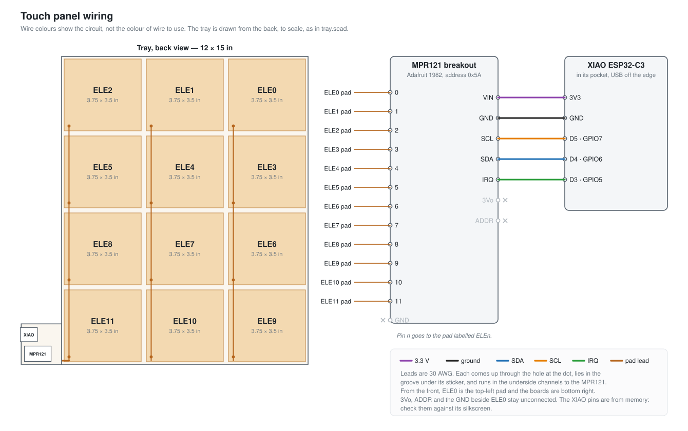

# Touch panel

A 12 × 15 inch panel of 12 copper pads that senses a hand above it, recognises a swipe
across the top row and back, and toggles a light. An MPR121 reads the pads and a XIAO
ESP32-C3 runs the firmware, which also reports the hand's position over Bluetooth LE.
`docs/DESIGN.md` explains how it works.



| Folder | What is in it |
|---|---|
| `cad/` | `tray.scad`, the 3D-printed tray that holds the pads and the boards, and in `cad/tools/` the scripts that make it printable |
| `docs/` | the design notes and the wiring diagram |
| `firmware/` | the ESP-IDF project for the XIAO, and in `firmware/tools/` the programs that talk to the board from a Mac |
| `pcb/` | the next version: the whole panel as one PCB with an ESP32-S3 and no MPR121, generated from Python (see `pcb/README.md`) |

## Printing the tray

`cad/tools/plate.sh` exports the four tiles from `cad/tray.scad` and puts them on four
plates of a Bambu Studio project for a Bambu Lab X2D, `cad/build/tray.3mf`. It needs
OpenSCAD and Bambu Studio installed where the script expects them.

## Flashing the firmware

The firmware needs ESP-IDF v6. The Wi-Fi network's name and password go in
`firmware/main/wifi_secrets.h`, which git ignores: copy `wifi_secrets.h.example` next
to it and fill it in. The build compiles them into the firmware, so the board can join
the network. The name of the Kasa switch to toggle is `KASA_ALIAS` in
`firmware/main/kasa.h`. The same firmware builds for either board; only the sensor
differs, and `firmware/tools/build.sh` picks it:

```
firmware/tools/build.sh xiao flash    # the XIAO ESP32-C3 with the MPR121
firmware/tools/build.sh pcb flash     # the ESP32-S3 PCB in pcb/
```

## Using it

`firmware/tools/monitor.py` shows what the board sees over USB.
`firmware/tools/ble_view.py` draws the hand's position from Bluetooth in a window, and
`firmware/tools/ble_talker.py` speaks the pad under the hand. Each runs with
[uv](https://docs.astral.sh/uv/), which installs its dependencies.
