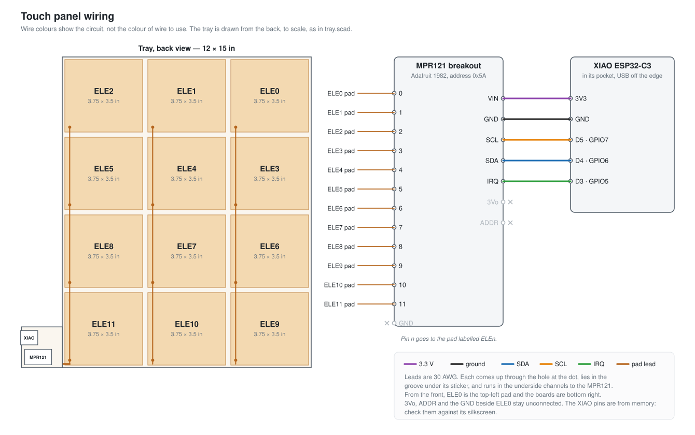

# Sensing a hand over a 12 × 15 inch panel

An Adafruit MPR121 breakout (product 1982) measures the capacitance of 12 copper pads,
3 across and 4 down, on a 3D-printed tray 12 inches wide and 15 tall, and a Seeed XIAO
ESP32-C3 reads it over I2C. A hand above the panel adds capacitance to the pads beneath
it, most to the nearest, so the firmware takes the hand's position as the centroid of
the 12 changes. A sequence of pads under that centroid is a gesture, and the board
toggles a light when it sees one.

Facts about the MPR121 below that are not from Adafruit's product page or Eagle files
come from my memory of NXP's datasheet and Adafruit's library, and I have not rechecked
them.

## Range

A hand 2 in (5 cm) over a 3.75 × 3.5 in pad couples at most about ε₀A/d = 8.85 pF/m ×
85 cm² / 5 cm ≈ 1.5 pF to it, which is a parallel-plate upper bound; the real figure is
lower because the hand covers only part of the pad. That is why the pads fill their
cells with only narrow gaps. On the built panel, a hand at gesture height moves the
nearest pad by about 20 counts of the MPR121's 10-bit reading, against noise of about
±1 count.

## The tray

- The tray is `cad/tray.scad`, 3 mm thick. It is larger than the Bambu Lab X2D's 256 mm
  bed, so it prints as four tiles that are glued together at dovetails. The seams fall
  in the gaps between pads, and the widest tile is 209 mm, inside the 235 mm the X2D's
  right nozzle can reach. `cad/tools/plate.sh` exports the tiles and puts them on four
  plates of one Bambu Studio project, in `cad/build/`.
- Each cell is 4 in wide and 3.75 in tall. The pads are copper foil stickers, 3.75 ×
  3.5 in, each laid in a 0.4 mm recess on the top face, which leaves a 1/4 in gap
  between neighbours. Electrode numbers run left to right and top to bottom when viewed
  from the front: row 1 is ELE0–2, and row 4 is ELE9–11.
- Each pad's wire is 30 AWG. It comes up through a hole 6 mm in from the pad's
  bottom-right corner, its stripped end lies in a 10 mm groove under the sticker, and
  the sticker is soldered to it there. On the underside, the wires run down one channel
  per column and then along a trunk at the bottom edge, and each hole is engraved with
  its electrode number. A wire is sensitive too, but its area is under 1 cm² against
  85 cm² of pad, so it hardly shifts the centroid.
- The MPR121 and the XIAO sit in 1.2 mm pockets on a 50 × 50 mm tab beside the
  bottom-right corner, 12 mm from the nearest pad, because ground near a pad takes the
  field that should reach the hand. The MPR121 lies with its electrode row over a slot
  at the end of the trunk, so each wire comes up from below straight into its pin. The
  XIAO's USB-C end overhangs the tab's edge by 1 mm, so the plug fits. A dab of hot glue
  holds each board in its pocket.

## Wiring

`firmware/tools/wiring_diagram.py` draws the diagram.

| MPR121 breakout | XIAO ESP32-C3 |
|---|---|
| VIN | 3V3 |
| GND | GND |
| SDA | D4 (GPIO6) |
| SCL | D5 (GPIO7) |
| IRQ | D3 (GPIO5) |

The breakout's ADDR pin stays unconnected, which leaves it at address 0x5A, and so do
3Vo and the GND pin at the end of the electrode row, which is the same net as the GND
on the power row. The firmware polls rather than using IRQ.

## Firmware

The firmware is an ESP-IDF v6 project in `firmware/`, and it runs 20 frames a second.

- At start-up it resets the MPR121 and lets the chip pick each pad's charge current and
  time itself, through its auto-configuration registers, for readings near 720.
- Each pad's change is its reading subtracted from a background, a first-order low-pass
  of its past readings with a 10 s time constant. The background holds still while any
  pad's change is above 3 counts, because a hand would otherwise drag it down, and
  repeated gestures then leave the idle readings several counts negative.
- The centroid is the average of the pads' positions, each weighted by how far its
  change exceeds 2 counts. The pad token is the pad whose centre the centroid is within
  0.4 of a cell of, -1 while it is between pads, or -2 when no pad is above 2 counts.
- The gesture is the token sequence `2+1+0+1+2+` in regular-expression notation,
  matched by a five-state machine in `gesture.c`. Frames between pads or with no hand
  are skipped, so lifting the hand at the turn does not break the match, but a second
  of them starts it over.
- Each time the gesture completes, the board toggles a TP-Link Kasa switch on the
  Wi-Fi, named in `kasa.h`, over Kasa's local protocol on port 9999. That protocol works
  without a login on older Kasa firmware, such as 1.1.3 on the HS103 used here. The
  board finds the switch by name with Kasa's discovery broadcast, so a new DHCP address
  does not break it.
- While the centroid shows, the board sends it over Bluetooth LE: it advertises as
  "Touch Panel", and one notify characteristic carries "x,y,pad", with x and y in
  inches from the panel's top-left corner seen from the front.
- Over USB, it draws the 12 changes as a colour-coded grid with the centroid as a red
  dot, the pad token and its recent history, and the state of the Wi-Fi, the switch and
  Bluetooth. The keys b (new background), t (toggle the switch), r (one text line per
  frame) and g (back to the grid) control it.

With Wi-Fi and Bluetooth together the app is about 1.1 MB, so the firmware uses
ESP-IDF's large single-app partition table.

## Programs on the Mac

All of these are in `firmware/tools/` and run with `uv`, which installs their dependencies.

- `monitor.py` shows the USB grid and passes b and q through.
- `ble_monitor.py` prints the Bluetooth packets.
- `ble_view.py` draws the centroid in a window, with a trail that fades over about
  7 seconds.
- `ble_talker.py` speaks the pad under the hand through the Mac's speaker.

The panel takes one Bluetooth connection at a time, so only one of the last three can
be connected.
