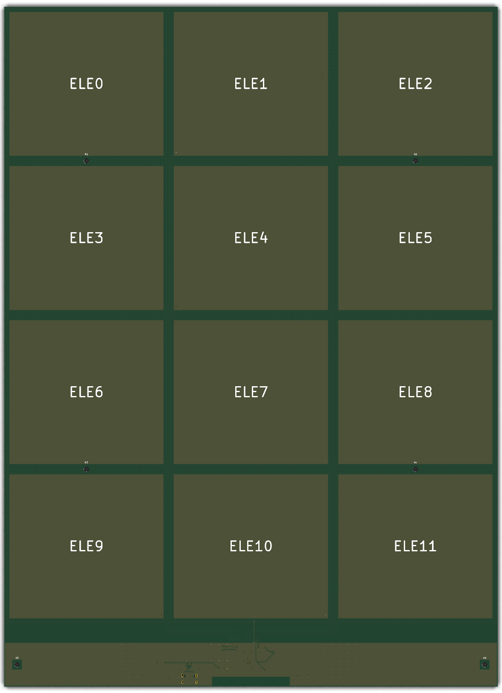

# The touch panel as one PCB

This replaces the printed tray, the copper stickers, the hand wiring and the two boards
with a single 2-layer board, 304.8 × 420 mm. The 12 pads are top copper under solder
mask, in the tray's grid. An ESP32-S3-WROOM-1 module senses them itself with its touch
inputs, so the board has no MPR121, which NXP has discontinued. The module sits in a
strip below the pads with USB-C, a 3.3 V regulator, reset and boot buttons and an LED.
Every part is on the back, so the front is only the pads and can lie flat against a
desk; the pads' traces stay on the back all the way to their resistors.



Everything here is generated from Python, so the design is in `tools/`, and the KiCad
files are its output:

| File | What it is |
|---|---|
| `tools/design.py` | every part, its footprint and LCSC number, and the net on each pin |
| `tools/make_schematic.py` | writes `touch_panel.kicad_sch` from it |
| `tools/make_board.py` | writes `touch_panel.kicad_pcb`: places the parts, draws the pad traces and zones, and routes the strip with `strip_router.py` |
| `tools/make_footprints.py` | writes the pad and shield-tap footprints in `touch_panel.pretty` |
| `tools/make_lib_tables.py` | writes the project's library tables |
| `tools/make_fab.py` | writes the gerbers, BOM, placement file and schematic PDF into `fab/` |

## The layout

- Each pad's signal leaves through a via in its corner to the bottom layer and runs down
  one of the two vertical gaps between pad columns, six traces to a gap, in an order that
  keeps them from crossing. Below the pads they return to the top layer as a bus, to a
  510 Ω resistor each above the module, as Espressif's hardware design guidelines ask.
- The bottom layer under the pads is a hatched shield driven by GPIO14, the only touch
  pin that can drive one. Driven with the same waveform as the pad being measured, it
  hides the pads from whatever is behind the board without loading them. The firmware
  can instead drive GPIO14 low, which grounds it, or leave it floating.
- The strip's copper is ground on both layers, starting 15 mm below the pads, so ground
  does not take the field the pads need. The module's antenna end is flush with the
  bottom edge, over its keepout.

## Rebuilding

The generators need KiCad 10. `make_board.py` and `make_fab.py` run in KiCad's own Python:

```
PY=~/Applications/KiCad/KiCad.app/Contents/Frameworks/Python.framework/Versions/Current/bin/python3
python3 pcb/tools/make_lib_tables.py
python3 pcb/tools/make_footprints.py
python3 pcb/tools/make_schematic.py
$PY pcb/tools/make_board.py
python3 pcb/tools/make_fab.py
```

The schematic passes KiCad's electrical rules check, and the board passes its design
rules check with the schematic parity check on, with only silkscreen warnings and a
note that the module's footprint differs from the library's: its 0.2 mm thermal vias
are removed, because JLCPCB's standard minimum hole is 0.3 mm.

## Ordering from JLCPCB

Upload `fab/touch_panel_gerbers.zip` as a 2-layer, 1.6 mm board, and for assembly on the
bottom side, `fab/touch_panel_bom.csv` and `fab/touch_panel_cpl.csv`. Before paying, check
each part's rotation in JLCPCB's assembly preview: KiCad's footprint orientation and
JLCPCB's part orientation differ for some parts, often the SOT-23 and the USB-C
connector, and the files here have not been corrected for that.
